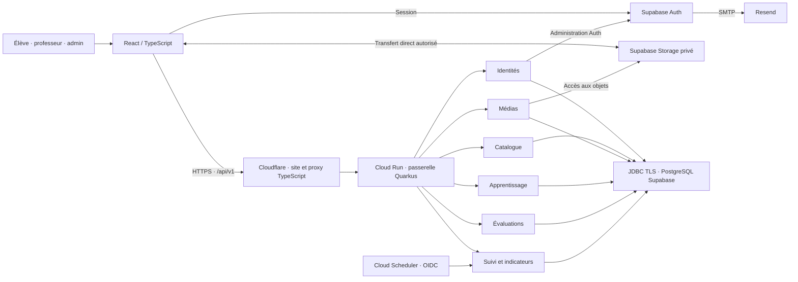

# LinguaCap — Architecture des microservices

LinguaCap propose des parcours d’allemand **A1 et A2 complets**. L’élève suit des cours qui mêlent texte, images, sons et exercices. Le professeur fixe l’objectif, suit l’avancement et corrige les productions. L’administration gère les comptes, le catalogue et les indicateurs. Le [cahier des charges](CAHIER_DES_CHARGES.md) définit les usages, le [backlog](PLAN_FONCTIONNALITES.md) en donne l’ordre de développement et le [plan de déploiement](PLAN_DEPLOIEMENT.md) décrit la CI et la mise en ligne.

Le backend cible comporte **six microservices Java 21 avec Quarkus, déployables séparément sur Google Cloud Run**. Une passerelle API Java est déployée sur Cloud Run. Un Worker Cloudflare TypeScript sert l’interface React sur `linguacap.emichfer.org` et relaie les routes API à la passerelle. Les services métier partagent une instance Supabase PostgreSQL pour le pilote avec un schéma privé et un rôle par service. La capacité et la sauvegarde de PostgreSQL restent communes.

## Vue d’ensemble



## Langages, outils et services externes

| Couche | Choix | Responsabilité |
| --- | --- | --- |
| Interface | React, TypeScript, HTML, CSS, Vite | Espaces élève, professeur et administration. Voix et lecture audio via les API du navigateur, avec dépôt de fichier en alternative. |
| Site et proxy | TypeScript, Cloudflare Workers et Wrangler | Fichiers statiques de Vite et relais de `/api/v1` vers Cloud Run. [Routage Cloudflare](https://developers.cloudflare.com/workers/static-assets/binding/) |
| Passerelle et microservices | Java 21, Quarkus REST, Maven, conteneurs JVM | API JSON et appels entre services avec authentification IAM. [Quarkus](https://quarkus.io/guides/getting-started/) · [Cloud Run](https://docs.cloud.google.com/run/docs/authenticating/service-to-service) |
| Données | SQL, PostgreSQL Supabase, JDBC | Un rôle SQL par service. Connexion TLS via le pooler Supabase en mode session au pilote. [Connexion Supabase](https://supabase.com/docs/guides/database/connecting-to-postgres) |
| Identité | Supabase Auth | Comptes, sessions, liens d’invitation et de récupération. LinguaCap décide des rôles pédagogiques et des rattachements. |
| Fichiers | Supabase Storage | Compartiments privés pour la médiathèque pédagogique et les productions des élèves. [Accès aux fichiers](https://supabase.com/docs/guides/storage/buckets/fundamentals) |
| E-mails | Resend via SMTP de Supabase Auth | Invitations et récupération de compte depuis `no-reply@notifications.emichfer.org`, après validation du domaine d’envoi. [SMTP personnalisé](https://supabase.com/docs/guides/auth/auth-smtp) |
| DNS et automatisation | Cloudflare et GitHub Actions, workflows YAML | Domaine HTTPS `linguacap.emichfer.org`, CI dès l’incrément 1 et livraisons depuis `production`. |
| Images et tâches planifiées | Artifact Registry et Cloud Scheduler | Conserver les images de conteneur par version et déclencher le traitement de Suivi via HTTP OIDC. [Authentification du Scheduler](https://docs.cloud.google.com/scheduler/docs/http-target-auth) |

## Microservices à développer

| Service et schéma SQL | Langage | Données dont il est responsable | Opérations principales |
| --- | --- | --- | --- |
| **Identités** · `identity` | Java 21, Quarkus, SQL | Profils, rôles, permissions, invitations, rattachements et correcteurs désignés. | Inviter ou réinviter, activer, gérer les accès, réaffecter un référent, attribuer les droits de correction. |
| **Catalogue** · `catalogue` | Java 21, Quarkus, SQL | Langues, niveaux, versions, compétences, modules, blocs de leçon, questions et grilles. | Éditer et prévisualiser un brouillon, vérifier sa complétude, publier et retirer une version, fournir les activités autorisées. |
| **Médias** · `media` | Java 21, Quarkus, SQL | Ressources, versions de fichier, métadonnées, dépôts et autorisations temporaires d’accès. | Importer, contrôler, retrouver et archiver les images et sons. Autoriser les dépôts et lectures de productions privées. |
| **Apprentissage** · `learning` | Java 21, Quarkus, SQL | Inscriptions, buts, disponibilités, séances, révisions du planning et progression. | Attribuer un parcours, produire et confirmer un calendrier, reprendre une séance, replanifier et enregistrer l’avancement. |
| **Évaluations** · `assessment` | Java 21, Quarkus, SQL | Tentatives, réponses, remises, corrections et résultats par compétence. | Évaluer le diagnostic et le bilan, orchestrer la remise d’un examen, autocorriger, enregistrer une correction humaine et calculer le résultat final. |
| **Suivi** · `tracking` | Java 21, Quarkus, SQL | Données de synthèse par élève, alertes, encouragements et agrégats par cohorte. | Actualiser les fiches professeur, détecter les retards, traiter les relances et calculer les KPI administrateur. Le traitement périodique est déclenché par Cloud Scheduler. |

La passerelle identifie l’utilisateur, valide la requête et appelle le service concerné. Les services utilisent l’identité Google Cloud de leur compte d’exécution et leurs droits d’invocation. Chaque action vérifie aussi le droit de l’utilisateur sur la ressource. Évaluations demande par exemple à Identités si le correcteur est habilité pour l’élève et à Médias si le fichier correspond à la tentative.

### Frontières des données et des accès

- Un service lit et écrit ses données avec un rôle SQL dédié. Les schémas métier sont privés et exclus de la Data API publique. Les autres services utilisent des contrats internes pour lire ou modifier ces données. Les identifiants interservices sont des références validées par le service propriétaire.
- Les clients utilisent la clé publiable et leur session Supabase pour se connecter et transférer les fichiers autorisés. La passerelle vérifie le jeton Auth, notamment la signature, l’émetteur et l’expiration. Identités gère les permissions à partir de ses données. Une valeur de rôle envoyée par le navigateur ne confère aucun droit.
- Identités détient seul la clé d’administration Auth, via Secret Manager. Les rôles PostgreSQL d’exécution sont distincts du rôle de migration. Les accès Storage sont limités par les politiques d’objet et d’utilisateur.
- La passerelle Cloud Run est joignable depuis le Worker et vérifie le secret de liaison ainsi que la session pour les routes métier. Les six services Cloud Run exigent le droit IAM `roles/run.invoker`. Sur les appels utilisateur, le jeton Supabase est dans `Authorization` et le jeton Google dans `X-Serverless-Authorization`. Cloud Scheduler dispose d’une identité dédiée sur la route de traitement de Suivi. [Authentification Cloud Run](https://docs.cloud.google.com/run/docs/authenticating/service-to-service)
- Le proxy traite les réponses personnalisées et les liens privés hors du cache partagé. La configuration et les secrets sont séparés par environnement.

### Contrats et échanges entre services

L’API publique versionnée distingue les parcours utilisateur et les actions d’administration. Les appels internes utilisent des contrats explicites et des délais bornés. Toute erreur remonte un code exploitable et un identifiant de requête, sans inclure les corrigés, les données de connexion ou les liens signés. Les opérations sensibles à une répétition, comme une invitation, une publication ou une remise, utilisent une clé d’idempotence ou une contrainte métier équivalente.

| Exemple de contrat | Responsable | Résultat |
| --- | --- | --- |
| `POST /api/v1/invitations` | Identités | Référence d’invitation et état de traitement. |
| `POST /api/v1/media/uploads` puis `POST /api/v1/media/{id}/finalize` | Médias | Autorisation limitée au dépôt, puis statut après contrôle de l’objet. |
| `POST /api/v1/catalogue/versions/{id}/publish` | Catalogue | Version publiée et identifiant stable pour une future inscription. |
| `POST /api/v1/goals/{id}/plan` puis validation du plan | Apprentissage | Proposition de séances et révision validée. |
| `POST /api/v1/attempts/{id}/submit` | Évaluations | Remise horodatée et état de correction. |
| `GET /api/v1/admin/kpis` | Suivi | Indicateurs correspondant aux filtres et date de dernière actualisation. |

Les comptes, séances et tentatives enregistrent leurs événements métier avec leur transaction, dans une table de sortie appartenant à chaque service. Suivi les récupère par lots depuis les services propriétaires et les applique à ses tables de synthèse. Il déduplique par identifiant d’événement et confirme le traitement après enregistrement. Un lot interrompu peut être repris. Les événements portent les identifiants, les états et les horodatages utiles. Les copies, enregistrements et mots de passe restent hors des événements.

## Modèle de données et règles métier

| Domaine | Entités et relations principales | Règles à garantir en base ou dans le service propriétaire |
| --- | --- | --- |
| Identités | `profile` lié à l’utilisateur Auth, avec un rôle admin, teacher, learner ou staff (Équipe) et un état actif ou désactivé, `permission` (catalogue, correction), `invitation`, `teacher_assignment`, `reviewer_assignment`, `outbox_events`. | Un référent actif par élève. Réémission liée à l’invitation initiale. Réaffectation sans perte d’historique. Le changement de référent est pris en compte pour les nouveaux accès. |
| Catalogue | `language` → `level` → `track_version` → `module` → `activity` → blocs et questions. `media_placement` associe une version de fichier à un bloc ou à une question. | Une version publiée fige les blocs, leur ordre, les versions de fichiers, le texte alternatif et la grille. Une nouvelle version peut retirer des blocs ou en remplacer les médias. |
| Médias | `asset` → `asset_version` avec compartiment, chemin généré, type, taille, état, dimensions ou durée et crédit. `upload` et `storage_grant` décrivent les accès temporaires. | Un chemin physique est unique et le fichier validé est immuable. La médiathèque archive les ressources. Un média référencé par un parcours publié reste lisible pour les élèves autorisés. |
| Apprentissage | `enrollment` référence une version publiée. `goal`, `availability`, `plan_revision`, `session` et `activity_progress` enregistrent l’exécution. | La date cible initiale reste disponible. Une nouvelle révision touche les séances restantes et conserve les activités terminées et les retards déjà constatés. |
| Évaluations | `attempt` référence l’évaluation et sa version. `answer`, `submission`, `score` et `grading` lient la remise à la grille et aux éventuels médias privés. | La date de remise est distincte de la date de correction. Chaque tentative garde son résultat. Une réussite remise à temps reste comptée à temps si la correction intervient après l’échéance. |
| Suivi | `learner_summary`, `alert`, `encouragement`, `processed_event` et données de cohorte. | Une alerte ouverte par objectif. La connexion est distincte du temps de pratique. Les KPI conservent les fenêtres d’observation et les échéances nécessaires aux comparaisons. |

Les horodatages sont enregistrés côté serveur. Le planning utilise le fuseau de l’élève pour transformer ses jours et créneaux en échéances. Les écrans de suivi indiquent la dernière actualisation des données agrégées. Les vérifications d’accès utilisent l’état courant du service Identités.

## Images, sons et productions orales

### Bibliothèque pédagogique et éditeur

Le catalogue propose une médiathèque où l’éditeur peut déposer une ressource, la retrouver et la réutiliser. Une leçon peut associer plusieurs blocs de texte, images et sons. Un exercice peut afficher une image ou une consigne audio. Chaque insertion fixe l’ordre, la légende, le texte alternatif de l’image ou la transcription de l’audio selon son usage. Une transcription ou une description qui donnerait la réponse est réservée à l’étape pédagogique appropriée. La ressource conserve son origine et son crédit ou sa licence lorsque ces informations s’appliquent.

Les formats du pilote sont choisis pour une lecture sur ordinateur et mobile. L’éditeur accepte JPEG, PNG et WebP pour les images et prévoit MP3 pour les sons préparés. La remise orale utilise l’enregistrement compatible du navigateur ou le dépôt d’un fichier dans les formats validés en recette. Les plafonds de taille et de durée sont configurables par type. Une politique peut, par exemple, limiter davantage une image d’exercice qu’une production orale. Les fichiers destinés au cours sont préparés et compressés avant leur publication.

### Dépôt, validation et accès

1. Médias contrôle le profil et le contexte du dépôt, crée une autorisation liée à l’utilisateur et réserve un chemin d’objet. Une ressource pédagogique requiert le droit Catalogue. Une remise orale requiert une tentative ouverte attribuée à l’élève.
2. Le navigateur envoie le fichier directement dans le compartiment privé Supabase Storage avec la session de l’utilisateur. La politique Storage vérifie que l’identité, le compartiment, le chemin et l’expiration correspondent à l’autorisation temporaire enregistrée par Médias. L’interface affiche la progression et permet de réessayer en cas de coupure. Les transferts susceptibles d’être plus longs peuvent utiliser l’envoi reprenable. [Envoi reprenable Supabase](https://supabase.com/docs/guides/storage/uploads/resumable-uploads)
3. À la finalisation, Médias vérifie l’objet réel, sa taille et son type, avec un contrôle de signature adapté aux formats acceptés. Le service enregistre l’état disponible ou rejeté et retourne une raison exploitable. Un média rejeté ou en attente bloque une publication ou une remise qui en dépend.
4. Pour lire le fichier, Médias vérifie l’attribution du parcours, l’accès au brouillon ou le droit sur la tentative. Il délivre une autorisation contrôlée par les politiques Storage. Quand le lecteur utilise une URL signée, le lien est de courte durée et peut être renouvelé après vérification. L’enregistrement oral est accessible à son élève et aux correcteurs habilités selon les règles d’administration.
5. Chaque publication et chaque remise gardent leurs versions de fichier. Le remplacement d’une ressource crée une nouvelle version. Les dépôts abandonnés et les objets rejetés sont recensés pour nettoyage par l’API Storage. La durée de conservation des productions d’élèves est définie avant l’ouverture du pilote.

L’interface doit permettre de déposer puis prévisualiser des médias, de mettre l’audio en pause et de le relancer. Les tests couvrent les formats acceptés, la reprise d’un dépôt, une image et un son utilisés dans une leçon et un exercice, ainsi que le refus d’accès à une production privée par un compte tiers.

## Parcours de bout en bout

**Inviter et attribuer.** Identités valide la demande et réserve l’invitation. Supabase Auth prépare le lien et Resend l’achemine. Le statut permet de distinguer l’invitation enregistrée et l’envoi en échec. L’activation rattache le compte vérifié au rôle et au référent prévus. Apprentissage attribue au compte actif une version publiée du niveau.

**Planifier et suivre un cours.** Évaluations publie le résultat du diagnostic. Apprentissage récupère les contenus nécessaires dans Catalogue, calcule la charge et place les activités, les révisions et les évaluations par ordre de prérequis. L’élève peut répartir plusieurs séances par jour. Les objectifs A1 en un mois et A2 en deux mois restent des échéances cibles. A2 suppose des acquis A1. Une modification valide une nouvelle révision du calendrier avec un contrôle de concurrence avant l’écriture.

**Remettre et corriger.** Évaluations ouvre la tentative sur la version attribuée. Le lecteur reçoit les questions et les médias autorisés. Les corrigés des questions fermées sont utilisés côté serveur après la remise. Le correcteur autorisé traite l’écrit et l’oral. Le résultat complet par compétence est communiqué à l’élève et alimente la progression et les statistiques.

**Alerter et mesurer.** Suivi actualise les synthèses par lots à partir des événements d’apprentissage et d’évaluation. Le contrôle planifié évalue le prochain jalon, tient compte des pauses et regroupe les retards dans une alerte par objectif. Les encouragements sont visibles dans l’espace élève. Le tableau de bord expose les six KPI du cahier des charges avec leurs filtres, leurs effectifs et la date d’actualisation.

## Environnements, livraisons et exploitation

- **Local et recette.** Développer sur `develop` avec Vite, Quarkus via Maven et Supabase CLI. Vérifier tôt le démarrage du premier conteneur Quarkus et sa connexion JDBC avec un rôle limité. Utiliser des données fictives.
- **CI et production.** Mettre en place GitHub Actions à l’incrément 1. Vérifier TypeScript et Java avant la livraison. Appliquer les migrations compatibles, déployer les images versionnées sur Cloud Run, puis le site et le proxy côté Cloudflare. Le [plan de déploiement](PLAN_DEPLOIEMENT.md) détaille les contrôles et la mise en ligne.
- **Retours arrière.** Chaque service peut recevoir une version compatible indépendamment. Une modification de contrat ou de schéma est introduite en plusieurs étapes afin que l’ancienne et la nouvelle version puissent cohabiter pendant le déploiement. Vérifier la récupération à partir d’un export PostgreSQL et d’une copie séparée des objets Storage.
- **Exploitation.** Relier les traces des services avec un identifiant de requête. Suivre les erreurs d’API, la latence, les invitations en échec, les dépôts bloqués et le retard des traitements de suivi. Garder les corrections, fichiers et secrets hors des journaux.

### Capacité de l’offre gratuite

L’objectif est de tenir dans les quotas gratuits pour le pilote. Cloud Run exige un compte de facturation. Prévoir zéro instance minimale, des pools JDBC bornés et un traitement planifié par lots. Mesurer les appels API, les connexions PostgreSQL et le trafic des médias avant l’ouverture. Les quotas et les postes de coût sont précisés dans le [plan de déploiement](PLAN_DEPLOIEMENT.md). [Tarifs Cloud Run](https://cloud.google.com/run/pricing) · [Free Tier Google Cloud](https://docs.cloud.google.com/free/docs/free-cloud-features)

## Organisation prévue du dépôt

```text
linguacap-react/             Interface React existante, à passer en TypeScript
workers/web-proxy/           Site Cloudflare et proxy TypeScript
services/api-gateway/        Passerelle API Quarkus
services/identity/           Comptes, droits et invitations
services/catalogue/          Contenus, niveaux et publication
services/media/              Médiathèque, dépôt et accès aux fichiers
services/learning/           Objectifs, calendrier et progression
services/assessment/         Remises, corrections et résultats
services/tracking/           Alertes, historique de suivi et KPI
contracts/                   Schémas JSON et contrats API versionnés
.github/workflows/           CI et livraison
supabase/migrations/         Migrations SQL par domaine et politiques Storage
tests/                      Contrats, intégration et parcours de recette
```

Le premier parcours technique est une invitation suivie d’une séance A1 comportant une image, un audio et un exercice fermé. Il mobilise les six services sur un périmètre réduit. Évaluations corrige le quiz et Suivi lit le résultat auprès des services propriétaires. Les examens complets, les projections, les alertes et les KPI sont ajoutés dans les incréments dédiés. La recette finale utilise les deux niveaux complets et un B1 de démonstration publié depuis l’administration.
